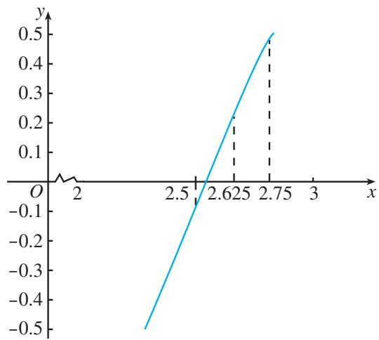

# 4.5.2 用二分法求方程的近似解·本节导语

我们已经知道，函数 $f(x) = \ln x + 2x - 6$ 在区间(2，3)内存在一个零点．进一步的问题是，如何求出这个零点呢？

一个直观的想法是：如果能将零点所在的范围尽量缩小，那么在一定精确度的要求下，就可以得到符合要求的零点的近似值。为了方便，可以通过取区间中点的方法，逐步缩小零点所在的范围。

取区间(2, 3)的中点2.5，用计算工具算得 $f(2.5) \approx -0.084$ . 因为 $f(2.5)f(3) < 0$ ，所以零点在区间(2.5, 3)内.

大多数方程都不能像一元二次方程那样用公式求出精确解。在实际问题中，往往只需求出满足一定精确度的近似解。

一般地，称 $x = \frac{a + b}{2}$ 为区间 $(a, b)$ 的中点.

再取区间(2.5, 3)的中点2.75，用计算工具算得 $f(2.75)\approx0.512$ 。因为 $f(2.5)f(2.75)<0$ ，所以零点在区间(2.5, 2.75)内。

由于 $(2,3)\mp (2.5,3)\mp (2.5,2.75)$ ，所以零点所在的范围变小了。如果重复上述步骤，那么零点所在的范围会越来越小（如表4.5-2和图4.5-3）。这样，我们就可以通过有限次重复相同的步骤，将零点所在范围缩小到满足一定精确度的区间，区间内的任意一点都可以作为函数零点的近似值。为了方便，我们把区间的一个端点作为零点的近似值。

表4.5-2

<table><tr><td>零点所在区间</td><td>中点的值</td><td>中点函数近似值</td></tr><tr><td>(2, 3)</td><td>2.5</td><td>-0.084</td></tr><tr><td>(2.5, 3)</td><td>2.75</td><td>0.512</td></tr><tr><td>(2.5, 2.75)</td><td>2.625</td><td>0.215</td></tr><tr><td>(2.5, 2.625)</td><td>2.5625</td><td>0.066</td></tr><tr><td>(2.5, 2.5625)</td><td>2.53125</td><td>-0.009</td></tr><tr><td>(2.53125, 2.5625)</td><td>2.546875</td><td>0.029</td></tr><tr><td>(2.53125, 2.546875)</td><td>2.5390625</td><td>0.010</td></tr><tr><td>(2.53125, 2.5390625)</td><td>2.53515625</td><td>0.001</td></tr></table>

  
图4.5-3

例如，当精确度为0.01时，因为 $|2.5390625 - 2.53125| = 0.0078125 < 0.01$ ，所以区间(2.53125，2.5390625)内任意一点都可以作为零点的近似值，也可以将 $x = 2.53125$ 作为函数 $f(x) = \ln x + 2x - 6$ 零点的近似值，也即方程 $\ln x + 2x - 6 = 0$ 的近似解.

对于在区间 $[a, b]$ 上图象连续不断且 $f(a)f(b) < 0$ 的函数 $y = f(x)$ ，通过不断地把它的零点所在区间一分为二，使所得区间的两个端点逐步逼近零点，进而得到零点近似值的方法叫做二分法（bisection method）.

给定精确度 $\varepsilon$ ，用二分法求函数 $y=f(x)$ 零点 $x_{0}$ 的近似值的一般步骤如下：

1. 确定零点 $x_{0}$ 的初始区间 $[a, b]$ ，验证 $f(a)f(b)<0$ .

2. 求区间 $(a, b)$ 的中点 $c$ .

3. 计算 $f(c)$ ，并进一步确定零点所在的区间：

(1) 若 $f(c)=0$ （此时 $x_{0}=c$ ），则 c 就是函数的零点；

(2) 若 $f(a)f(c) < 0$ （此时 $x_0 \in (a, c)$ ），则令 $b = c$ ;

(3) 若 $f(c)f(b) < 0$ （此时 $x_0 \in (c, b)$ ），则令 $a = c$ .

4. 判断是否达到精确度 $\varepsilon$ ：若 $|a-b|<\varepsilon$ ，则得到零点近似值 a（或 b）；否则重复步骤 2～4。

为了刻画与准确值的接近程度，这里给出了精确度 $\varepsilon$ ，由 $|a - b| < \varepsilon$ 可知，区间 $[a, b]$ 中任意一个值都是零点 $x_0$ 满足精确度 $\varepsilon$ 的近似值（想一想，为什么）.

由函数零点与相应方程解的关系，我们可用二分法来求方程的近似解.

## 引出的知识

- [二分法](7cd3c9e008a91f3fc480f7b8.md)

## 本节相关知识（范围关联）

- [二分法](7cd3c9e008a91f3fc480f7b8.md)

## 所属组织

- [4.5.2 用二分法求方程的近似解](d34d8161bee95b1e04c964f8.md)
