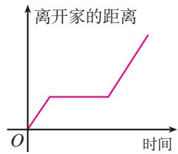
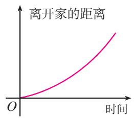
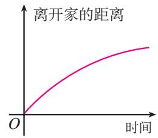
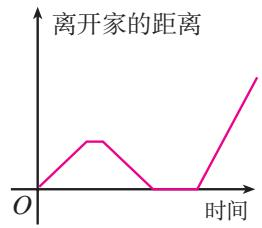

# 练习 1

1. 下图中哪几个图象与下述三件事分别吻合得最好？请你为剩下的那个图象写出一件事.

（1）我离开家不久，发现自己把作业本忘在家里了，于是返回家里找到了作业本再上学；

（2）我骑着车离开家后一路匀速行驶，只是在途中遇到一次交通堵塞，耽搁了一些时间；

（3）我从家出发后，心情轻松，一路缓缓加速行进.

  
(A)

  
(B)

  
(第1题)  
(C)

  
(D)

## 解析

本来源未提供本题解析。

## 本节相关知识（范围关联）

- [函数的三种表示法](64e8c150a9f7485ff2d5cee9.md)

## 所属组织

- [3.1.2 函数的表示法](c6bd6c741b8fcdbcf3bafc40.md)
