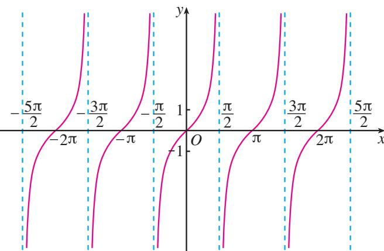

# 5.4.3 正切函数的性质与图象·探究

探究

你能借助以上结论，并根据正切函数的性质，画出正切函数的图象吗？正切函数的图象有怎样的特征？

根据正切函数是奇函数，只要画 $y = \tan x, x \in \left[0, \frac{\pi}{2}\right)$ 的图象关于原点的对称图形，就可得到 $y = \tan x, x \in \left(-\frac{\pi}{2}, 0\right]$ 的图象；根据正切函数的周期性，只要把函数 $y = \tan x, x \in \left(-\frac{\pi}{2}, \frac{\pi}{2}\right)$ 的图象向左、右平移，每次平移 $\pi$ 个单位，就可得到正切函数

$$
y = \tan x, x \in \mathbf {R}, x \neq \frac {\pi}{2} + k \pi , k \in \mathbf {Z}
$$

的图象，我们把它叫做正切曲线（tangent curve）（图 5.4-11）.

  
图5.4-11

从图5.4-11可以看出，正切曲线是由被与 $y$ 轴平行的一系列直线 $x = \frac{\pi}{2} + k\pi, k \in \mathbf{Z}$ 所隔开的无穷多支形状相同的曲线组成的.

## 本节相关知识（范围关联）

- [正切函数的值域](7ffc6367aac9a1775371d50f.md)
- [正切函数的单调性](11cb63ce24b22f7622e03ad4.md)
- [正切函数的周期性](c083bbb8cbe7df063558421f.md)
- [正切函数的奇偶性](98684ec3a2348c7b00ab9ba2.md)

## 所属组织

- [5.4.3 正切函数的性质与图象](a15c3022f04858ec42c9849e.md)
