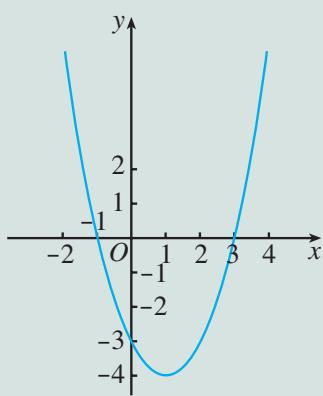

# 4.5.1 函数的零点与方程的解·探究

探究

对于二次函数 $f(x) = x^{2} - 2x - 3$ ，观察它的图象（图4.5-1），发现它在区间[2，4]上有零点。这时，函数图象与 $x$ 轴有什么关系？在区间[-2，0]上是否也有这种关系？你认为应如何利用函数 $f(x)$ 的取值规律来刻画这种关系？

再任意画几个函数的图象，观察函数零点所在区间，以及这一区间内函数图象与 $x$ 轴的关系，并探究用 $f(x)$ 的取值刻画这种关系的方法.

  
图4.5-1

可以发现，在零点附近，函数图象是连续不断的，并且“穿过” $x$ 轴。函数在端点 $x = 2$ 和 $x = 4$ 的取值异号，即 $f(2)f(4) < 0$ ，函数 $f(x) = x^2 - 2x - 3$ 在区间（2，4）内有零点 $x = 3$ ，它是方程 $x^2 - 2x - 3 = 0$ 的一个根。同样地， $f(-2)f(0) < 0$ ，函数 $f(x) = x^2 - 2x - 3$ 在 $(-2, 0)$ 内有零点 $x = -1$ ，它是方程 $x^2 - 2x - 3 = 0$ 的另一个根。

一般地，我们有：

函数零点存在定理 如果函数 $y = f(x)$ 在区间 $[a, b]$ 上的图象是一条连续不断的曲线，且有 $f(a)f(b) < 0$ ，那么，函数 $y = f(x)$ 在区间 $(a, b)$ 内至少有一个零点，即存在 $c \in (a, b)$ ，使得 $f(c) = 0$ ，这个 $c$ 也就是方程 $f(x) = 0$ 的解.

## 引出的知识

- [函数零点存在定理](ac36d7d675bedfc384d87273.md)

## 本节相关知识（范围关联）

- [函数的零点与方程的解](eab18c0bc30b141cc574f055.md)
- [函数零点存在定理](ac36d7d675bedfc384d87273.md)

## 所属组织

- [4.5.1 函数的零点与方程的解](8b49d21292d6dd54b47f88a9.md)
