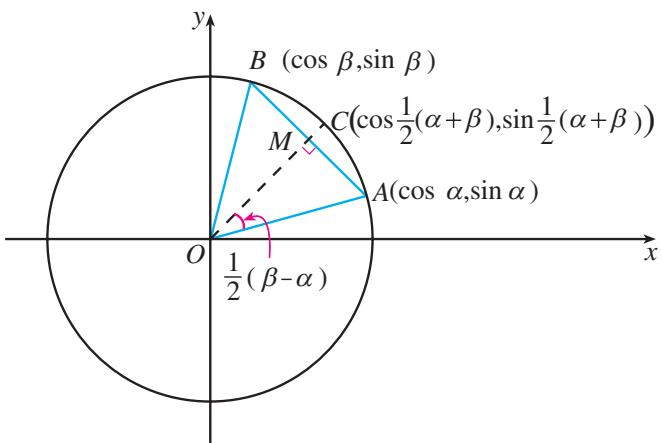

# 习题5.5 拓广探索 第19题

19. 你能利用所给图形，证明下列两个等式吗？

$$
\frac {1}{2} (\sin \alpha + \sin \beta) = \sin \frac {\alpha + \beta}{2} \cos \frac {\alpha - \beta}{2};
$$

$$
\frac {1}{2} (\cos \alpha + \cos \beta) = \cos \frac {\alpha + \beta}{2} \cos \frac {\alpha - \beta}{2}.
$$

  
(第 19 题)

## 解析

本来源未提供本题解析。

## 本节相关知识（范围关联）

- [利用信息技术制作三角函数表](87322f9d3043e64d8e20b3c6.md)

## 所属组织

- [习题5.5](7d94cfc9b2225ed52515a3c8.md)
