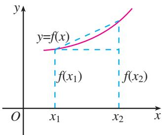
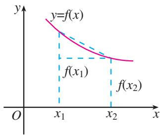

# 函数的单调性

## 情境引入与思考

## 知识讲解

## 定义摘录（来源原文）

一般地，设函数 $f(x)$ 的定义域为 D，区间 $I \subseteq D$ ：

如果 $\forall x_{1}, x_{2} \in I$ ，当 $x_{1} < x_{2}$ 时，都有 $f(x_{1}) < f(x_{2})$ ，那么就称函数 $f(x)$ 在区间 $I$ 上单调递增（图3.2-3（1））.

特别地，当函数 $f(x)$ 在它的定义域上单调递增时，我们就称它是增函数（increasing function）.

  
(1)

  
(2)  
图3.2-3

如果 $\forall x_{1}, x_{2} \in I$ ，当 $x_{1} < x_{2}$ 时，都有 $f(x_{1}) > f(x_{2})$ ，那么就称函数 $f(x)$ 在区间 $I$ 上单调递减（图3.2-3（2））.

特别地，当函数 $f(x)$ 在它的定义域上单调递减时，我们就称它是减函数（decreasing function）.

如果函数 $y = f(x)$ 在区间 $I$ 上单调递增或单调递减，那么就说函数 $y = f(x)$ 在这一区间具有（严格的）单调性，区间 $I$ 叫做 $y = f(x)$ 的单调区间.

## 先修知识

- [函数的概念](e168e67a14a1e592576457b6.md)

## 本节例题与练习

- [例 1 根据定义](f10373064b3adaa153f2bc18.md)
- [例 2 物理学中的玻意耳定律 $p =](../%E4%B9%A0%E9%A2%98/Q16327971006303067450.md)
- [例 3 根据定义证明函数 $y=x+\](../%E4%B9%A0%E9%A2%98/Q13425100634548111319.md)
- [函数单调性练习](25675a170fa3e6ef59ce5e49.md)
- [求区间上函数的最值](b2ea54c251b02b4d0a04c45c.md)
- [烟花高度的最大值](8367ca3121ec06bc48df4a5c.md)
- [练习 1](67ddaebea342f745357256bc.md)
- [练习 1](4b34435eddda699df0836f12.md)
- [练习 2](2b54178826bd7aadf7e19292.md)
- [练习 2](c2829732d87954faeb051c87.md)
- [练习 3](1021d10c66eec5bef76239d6.md)
- [练习 3](a08fcf43991859240a2b79b7.md)

## 所属组织

- [3.2.1 单调性与最大（小）值](3159f3558a51f867fb8196ff.md)

## 相关练习组织（范围关联）

- [3.2.1 单调性与最大（小）值](579a9421519702a88a2259af.md)
