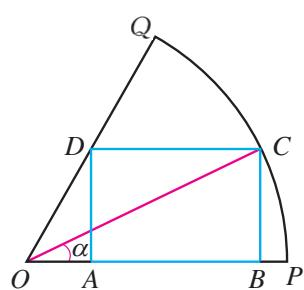

# 扇形中矩形面积的最值

例10 如图5.5-2，在扇形 $OPQ$ 中，半径 $OP = 1$ ，圆心角 $\angle POQ = \frac{\pi}{3}$ ， $C$ 是扇形弧上的动点，矩形ABCD内接于扇形．记 $\angle POC = \alpha$ ，求当角 $\alpha$ 取何值时，矩形ABCD的面积最大？并求出这个最大面积.

## 本节相关知识（范围关联）

- [三角恒等变换中的化归思想](f37c657deaca245e297fc80a.md)
- [半角公式与三角恒等变换](987b879d3a5c27d886f1e525.md)

## 解析

- [扇形中矩形面积的最值·解析](1300211896107b9e77474e5c.md)

## 所属组织

- [5.5.2 简单的三角恒等变换](f3c8fcd5f13da62cba37eafb.md)
