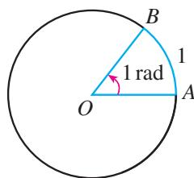

# 弧度制

## 情境引入与思考

## 知识讲解

## 定义摘录（来源原文）

我们规定：长度等于半径长的圆弧所对的圆心角叫做1弧度（radian）的角，弧度单位用符号rad表示，读作弧度.

我们把半径为 1 的圆叫做单位圆. 如图 5.1-11, 在单位圆 $O$ 中, $\widehat{AB}$ 的长等于 1, $\angle AOB$ 就是 1 弧度的角.

根据上述规定，在半径为 $r$ 的圆中，弧长为 $l$ 的弧所对的圆心角为 $\alpha$ rad，那么

  
图5.1-11

$$
| \alpha | = \frac {l}{r}.
$$

其中， $\alpha$ 的正负由角 $\alpha$ 的终边的旋转方向决定，即逆时针旋转为正，顺时针旋转为负。当角的终边旋转一周后继续旋转，就可以得到弧度数大于 $2\pi$ 或小于 $-2\pi$ 的角。这样就可以得到弧度为任意大小的角。

一般地，正角的弧度数是一个正数，负角的弧度数是一个负数，零角的弧度数是0.

## 先修知识

- [任意角、正角与负角](944530df8a61d867eabd2567.md)

## 后续知识

- [任意角的三角函数](d6579876f2b8688c35e74ca4.md)
- [角度与弧度的换算](967b5bb57870c485bea902c5.md)

## 本节例题与练习

- [例 4 按照下列要求](40e51bb9032368f99ca4ce3f.md)
- [例 5 将 3.14 rad 换算成角](d8da144ac92613b69f17fa8b.md)
- [例 6 利用弧度制证明下列关于扇形的公](54cf79ddd9b9012ad18a6fd7.md)
- [练习 1](791410b03bf2fe8a5dc03224.md)
- [练习 2](b347557cf3a25bd987acc7ed.md)
- [练习 3](9fcd3a0be92a931de99c8c03.md)
- [练习 4](21f4936f55657654f65bc8fb.md)
- [练习 5](42f62f4a421290625a846ff9.md)
- [练习 6](aa53b92e74c6228ffa5091e6.md)

## 所属组织

- [5.1.2 弧度制](daaaa06b1ab5fb2022394986.md)

## 相关练习组织（范围关联）

- [5.1.2 弧度制](b681f208fb1584a84076e567.md)
