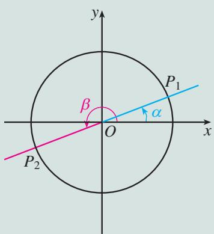
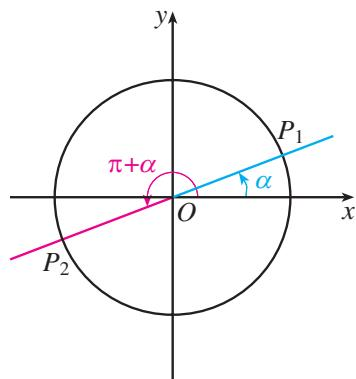

# 诱导公式二、三、四

## 情境引入与思考

## 知识讲解

## 定义摘录（来源原文）

前面利用圆的几何性质，得到了同角三角函数之间的基本关系。我们知道，圆的最重要的性质是对称性，而对称性（如奇偶性）也是函数的重要性质。由此想到，可以利用圆的对称性，研究三角函数的对称性。

如图 5.3-1，在直角坐标系内，设任意角 $\alpha$ 的终边与单位圆交于点 $P_{1}$ .

（1）作 $P_{1}$ 关于原点的对称点 $P_{2}$ ，以 $OP_{2}$ 为终边的角 $\beta$ 与角 $\alpha$ 有什么关系？角 $\beta, \alpha$ 的三角函数值之间有什么关系？

（2）如果作 $P_{1}$ 关于 $x$ 轴（或 $y$ 轴）的对称点 $P_{3}$ （或 $P_{4}$ ），那么又可以得到什么结论？

  
图5.3-1

下面，借助单位圆的对称性进行探究.

如图 5.3-2，以 $OP_{2}$ 为终边的角 $\beta$ 都是与角 $\pi + \alpha$ 终边相同的角，即 $\beta = 2k\pi + (\pi + \alpha)(k \in \mathbf{Z})$ 。因此，只要探究角 $\pi + \alpha$ 与 $\alpha$ 的三角函数值之间的关系即可。

设 $P_{1}(x_{1},y_{1})$ ， $P_{2}(x_{2},y_{2})$ .因为 $P_{2}$ 是点 $P_{1}$ 关于原点的对称点，所以

$$
x _ {2} = - x _ {1}, y _ {2} = - y _ {1}.
$$

根据三角函数的定义，得

$$
\sin \alpha = y _ {1}, \quad \cos \alpha = x _ {1}, \quad \tan \alpha = \frac {y _ {1}}{x _ {1}};
$$

$$
\sin (\pi + \alpha) = y _ {2}, \cos (\pi + \alpha) = x _ {2}, \tan (\pi + \alpha) = \frac {y _ {2}}{x _ {2}}.
$$

  
图5.3-2

从而得

角 $\pi + \alpha$ 还可以看作是角 $\alpha$ 的终边按逆时针方向旋转角 $\pi$ 得到的.

公式二

$$
\begin{array}{l} \sin (\pi + \alpha) = - \sin \alpha , \\ \cos (\pi + \alpha) = - \cos \alpha , \\ \tan (\pi + \alpha) = \tan \alpha . \end{array}
$$

如图 5.3-3，作 $P_{1}$ 关于 x 轴的对称点 $P_{3}$ ，则以 $OP_{3}$ 为终边的角为 $-\alpha$ ，并且有

公式三

$$
\begin{array}{l} \sin (- \alpha) = - \sin \alpha , \\ \cos (- \alpha) = \cos \alpha , \\ \tan (- \alpha) = - \tan \alpha . \end{array}
$$

如图 5.3-4，作 $P_{1}$ 关于 y 轴的对称点 $P_{4}$ ，则以 $OP_{4}$ 为终边的角为 $\pi-\alpha$ ，并且有

公式四

$\sin (\pi -\alpha) = \sin \alpha ,$ $\cos (\pi -\alpha) = -\cos \alpha ,$ $\tan (\pi -\alpha) = -\tan \alpha .$

## 先修知识

- [同角三角函数的基本关系](0fa9cf1bab7e2a538bc0816b.md)

## 本节例题与练习

- [三角函数值填表练习](951b7a44c64de13100433f0b.md)
- [习题5.3 复习巩固 第1题](42cd95277b7a6772fd05cb7b.md)
- [习题5.3 复习巩固 第2题](84a60f35501b3a963271f909.md)
- [习题5.3 复习巩固 第3题](44ea5c650c4c232df671fb35.md)
- [习题5.3 复习巩固 第4题](a80887615eb4b2bcdc92fe87.md)
- [习题5.3 拓广探索 第10题](eb4931408b99e800d94217bf.md)
- [习题5.3 拓广探索 第9题](49297de8678a4f591e2345d4.md)
- [习题5.3 综合运用 第5题](6c8686b157530c536ad52281.md)
- [习题5.3 综合运用 第6题](db5ab12b9af01b69ce85b5f6.md)
- [习题5.3 综合运用 第7题](120460981649ce33b1ba6954.md)
- [习题5.3 综合运用 第8题](d089d0021d42a06ed14f54b0.md)
- [例 1 利用公式求下列三角函数值：](5a4472cd7a6a07f44afb808e.md)
- [例 2 化简](1b5e610416e7a7cb69919e3b.md)
- [利用诱导公式化简](a1d5f36e0b3b4d72c0ae1ac3.md)
- [已知角关系求正弦值](6b3f059a0657a50b1b4ada26.md)
- [练习 1](2c8db3ff2a2b5ad350f13eb1.md)
- [练习 1](f159e485787427e4c97da53b.md)
- [练习 2](5ed21b61d4e969cbc3875027.md)
- [练习 2](1e7faaa950c3e3bd8567839f.md)
- [练习 3](d10272f6cd3b9a1160f81f84.md)
- [证明诱导公式](cfd05be7776a243513bae0db.md)

## 所属组织

- [5.3 诱导公式](1735c72ff2b44a857835dd81.md)

## 相关练习组织（范围关联）

- [5.3 诱导公式](7b0eb16aadf3bc46be566a97.md)
