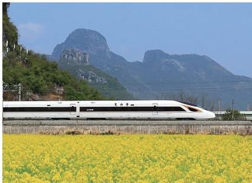

# 3.1.1 函数的概念·本节导语

先分析以下问题.

问题 1 某 “复兴号” 高速列车加速到 350 km/h 后保持匀速运行半小时。这段时间内，列车行进的路程 s（单位：km）与运行时间 t（单位：h）的关系可以表示为

$$
s = 3 5 0 t.
$$

这里， $t$ 和 $s$ 是两个变量，而且对于 $t$ 的每一个确定的值， $s$ 都有唯一确定的值与之对应，所以 $s$ 是 $t$ 的函数.

## 本节相关知识（范围关联）

- [函数的概念](e168e67a14a1e592576457b6.md)
- [函数相等的判定](78f29ddb08dd4175dc9c34f0.md)
- [区间](30cea9657253fa1465e5707a.md)

## 所属组织

- [3.1.1 函数的概念](0138f88a5c4732104b43752b.md)
