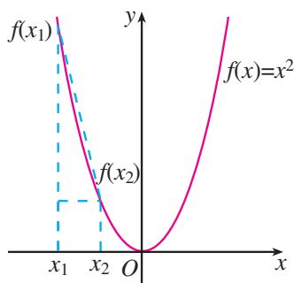

# 3.2.1 单调性与最大（小）值·本节导语

在初中，我们利用函数图象研究过函数值随自变量的增大而增大（或减小）的性质，这一性质叫做函数的单调性。下面进一步用符号语言刻画这种性质。

先研究二次函数 $f(x)=x^{2}$ 的单调性.

画出它的图象（如图3.2-2），可以看到：

图象在 $y$ 轴左侧部分从左到右是下降的，也就是说，当 $x \leqslant 0$ 时， $y$ 随 $x$ 的增大而减小。用符号语言描述，就是任意取 $x_1, x_2 \in (-\infty, 0]$ ，得到 $f(x_1) = x_1^2, f(x_2) = x_2^2$ ，那么当 $x_1 < x_2$ 时，有 $f(x_1) > f(x_2)$ 。这时我们就说函数 $f(x) = x^2$ 在区间 $(- \infty, 0]$ 上是单调递减的。

图3.2-2

图象在 $y$ 轴右侧部分从左到右是上升的，也就是说，当

你能说明为什么 $f(x_{1}) > f(x_{2})$ 吗？

$x \geqslant 0$ 时， $y$ 随 $x$ 的增大而增大。用符号语言表达，就是任意取 $x_1, x_2 \in [0, +\infty)$ ，得到 $f(x_1) = x_1^2, f(x_2) = x_2^2$ ，那么当 $x_1 < x_2$ 时，有 $f(x_1) < f(x_2)$ 。这时我们就说函数 $f(x) = x^2$ 在区间 $[0, +\infty)$ 上是单调递增的。

你能说明为什么 $f(x_{1}) < f(x_{2})$ 吗？

## 本节相关知识（范围关联）

- [函数的单调性](1736e3299fa73b1f3b43272b.md)
- [函数的最大值与最小值](9a4e786a118bb0b16388617b.md)

## 所属组织

- [3.2.1 单调性与最大（小）值](9af303a613f2f87dc1a18a92.md)
