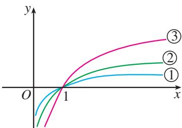

# 习题4.4 复习巩固 第4题

4. 函数 $y = \log_2 x$ ， $y = \log_5 x$ ， $y = \lg x$ 的图象如图所示，（1）试说明哪个函数对应于哪个图象，并解释为什么；（2）以已有图象为基础，在同一直角坐标系中画出 $y = \log_{\frac{1}{2}} x$ ， $y = \log_{\frac{1}{5}} x$ ， $y = \log_{\frac{1}{10}} x$ 的图象；（3）从（2）的图中你发现了什么？

## 解析

本来源未提供本题解析。

## 所属组织

- [习题4.4](daadeeeb2d4a0a8d7dd8bae3.md)
