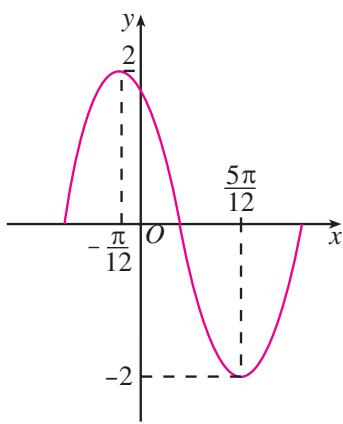

# 习题5.6 综合运用 第5题

5. 将函数 $y = 3\sin \left(2x + \frac{\pi}{4}\right)$ 的图象向左平移 $\frac{\pi}{3}$ 后得到函数 $y = g(x)$ 的图象，求 $y = g(x)$ 的解析式.

## 解析

本来源未提供本题解析。

## 所属组织

- [习题5.6](d61c5f4accd9d66a1abd11b0.md)
