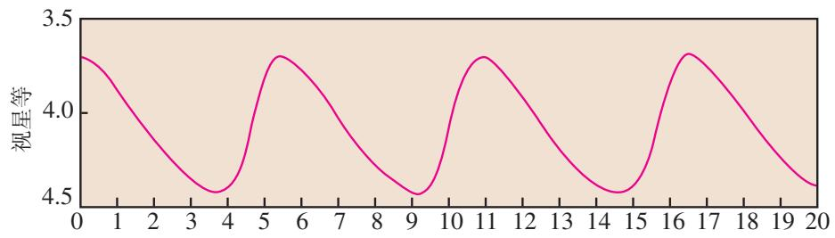

# 习题5.7 综合运用 第1题

1. 天上有些恒星的亮度是会变化的，其中一种称为造父（型）变星，本身体积会膨胀收缩造成亮度周期性的变化。下图是一造父变星的亮度随时间的周期变化图。此变星的亮度变化的周期为多少天？最亮时是几等星？最暗时是几等星？

  
(第1题)

## 解析

本来源未提供本题解析。

## 本节相关知识（范围关联）

- [三角函数模型的应用步骤](75ee85e3f5aaf3e4a982f9b1.md)

## 所属组织

- [习题5.7](6b9b45f2d14eebf5395f3a44.md)
