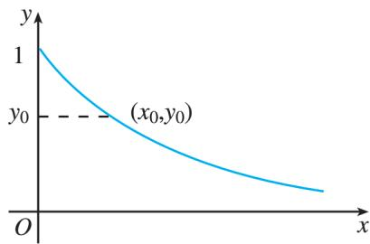

# 4.4.1 对数函数的概念·思考

思考

在 4.2.1 的问题 2 中，我们已经研究了死亡生物体内碳 14 的含量 y 随死亡时间 x 的变化而衰减的规律。反过来，已知死亡生物体内碳 14 的含量，如何得知它死亡了多长时间呢？进一步地，死亡时间 x 是碳 14 的含量 y 的函数吗？

根据指数与对数的关系，由 $y=\left(\frac{1}{2}\right)^{\frac{x}{5730}}(x\geqslant0)$ 得到 $x=\log_{\sqrt[730]{\frac{1}{2}}}y$ ( $0<y\leqslant1$ ). 如图 4.4-1，过 y 轴正半轴上任意一点 $(0,y_{0})(0<y_{0}\leqslant1)$ 作 x 轴的平行线，与 $y=\left(\frac{1}{2}\right)^{\frac{x}{5730}}(x\geqslant0)$ 的图象有且只有一个交点 $(x_{0},y_{0})$ . 这就说明，对于任意一个 $y\in(0,1]$ ，通过对应关系 $x=\log_{\sqrt[730]{\frac{1}{2}}}y$ ，在 $[0,+\infty)$ 上

  
图4.4-1

都有唯一确定的数 $x$ 和它对应，所以 $x$ 也是 $y$ 的函数。也就是说，函数 $x = \log_{5\sqrt[730]{\frac{1}{2}}} y, y \in (0, 1]$ 刻画了时间 $x$ 随碳14含量 $y$ 的衰减而变化的规律。

同样地，根据指数与对数的关系，由 $y=a^{x}(a>0$ ，且 $a\neq1)$ 可以得到 $x=\log_{a}y$ (a>0，且 $a\neq1$ )，x 也是 y 的函数。通常，我们用 x 表示自变量，y 表示函数。为此，将 $x=\log_{a}y$ (a>0，且 $a\neq1)$ 中的字母 x 和 y 对调，写成 $y=\log_{a}x$ (a>0，且 $a\neq1)$ 。

一般地，函数 $y=\log_{a}x(a>0$ ，且 $a\neq1)$ 叫做对数函数（logarithmic function），其中 x 是自变量，定义域是 $(0,+\infty)$ .

## 引出的知识

- [对数函数的概念](5cf1ba73e54db0585b1d8408.md)

## 本节相关知识（范围关联）

- [对数函数的概念](5cf1ba73e54db0585b1d8408.md)

## 所属组织

- [4.4.1 对数函数的概念](6358087ebc9a7c05b4d35212.md)
