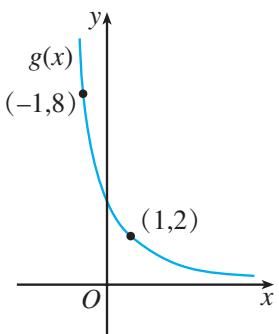

# 习题4.2 综合运用 第5题

5. 求下列函数可能的一个解析式：
(1) 函数 $f(x)$ 的数据如下表：

<table><tr><td>x</td><td>0</td><td>1</td><td>2</td></tr><tr><td>f(x)</td><td>3.50</td><td>4.20</td><td>5.04</td></tr></table>

(2) 函数 $g(x)$ 的图象如下:

  
(第 5 题)

## 解析

本来源未提供本题解析。

## 所属组织

- [习题4.2](ac829df621645e6729a2357a.md)
