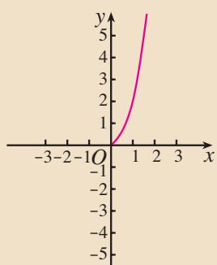

# 3.2.2 奇偶性·思考

思考

(1) 判断函数 $f(x)=x^{3}+x$ 的奇偶性.

(2) 图 3.2-9 是函数 $f(x) = x^3 + x$ 图象的一部分，你能根据 $f(x)$ 的奇偶性画出它在 $y$ 轴左边的图象吗？

（3）一般地，如果知道 $y = f(x)$ 为偶（奇）函数，那么我们可以怎样简化对它的研究？

  
图3.2-9

## 本节相关知识（范围关联）

- [偶函数](7d7d586e0d745b68b56a5671.md)
- [奇函数](acf246e7e23b68059c0fc330.md)

## 所属组织

- [3.2.2 奇偶性](5dee39cba56f604b7f0e24e5.md)
