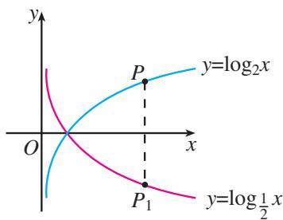

# 4.4.2 对数函数的图象和性质·思考

思考

我们知道，底数互为倒数的两个指数函数的图象关于 $y$ 轴对称。对于底数互为倒数的两个对数函数，比如 $y = \log_2 x$ 和 $y = \log_{\frac{1}{2}} x$ ，它们的图象是否也有某种对称关系呢？可否利用其中一个函数的图象画出另一个函数的图象？

利用换底公式，可以得到 $y = \log_{\frac{1}{2}}x = -\log_2x$ 。因为点 $(x, y)$ 与点 $(x, -y)$ 关于 $x$ 轴对称，所以 $y = \log_2x$ 图象上任意一点 $P(x, y)$ 关于 $x$ 轴的对称点 $P_1(x, -y)$ 都在 $y = \log_{\frac{1}{2}}x$ 的图象上，反之亦然。由此可知，底数互为倒数的两个对数函数的图象关于 $x$ 轴对称。根据这种对称性，就可以利用 $y = \log_2x$ 的图象画出 $y = \log_{\frac{1}{2}}x$ 的图象（图4.4-3）。

  
图4.4-3

为了得到对数函数 $y = \log_a x (a > 0$ ，且 $a \neq 1)$ 的性质，我们还需要画出更多具体对数函数的图象进行观察.

## 本节相关知识（范围关联）

- [4.4.2 对数函数的图象和性质·核心概念](7892f9c66d47c9b15187e539.md)
- [对数函数的图象和性质](fc15cf71bf5fd2b554fb5604.md)

## 所属组织

- [4.4.2 对数函数的图象和性质](b01de4905e447f85c6b8ebdd.md)
