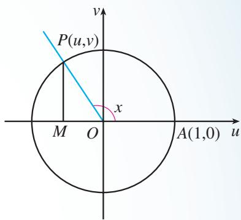

# 利用单位圆研究正弦函数与余弦函数的性质

根据三角函数的定义可知，“单位圆上点的坐标就是三角函数”。因此，单位圆的性质与三角函数的性质有天然的联系，单位圆是研究三角函数性质的好工具。例如，借助单位圆的对称性可以方便地得到诱导公式。借助单位圆研究三角函数的性质体现了数形结合的思想方法，有利于从整体上把握三角函数。

如图1，在直角坐标系 $uOv$ 中，角 $x$ 的顶点与原点重合，始边与 $Ou$ 轴重合，终边与单位圆交于点 $P(\cos x, \sin x)$ 。容易发现，当角 $x$ 的终边绕原点从 $Ou$ 轴的正半轴开始，按照逆时针方向旋转时，点 $P$ 的横坐标按照

$$
1 \rightarrow 0 \rightarrow - 1 \rightarrow 0 \rightarrow 1 \dots
$$

的规律连续地、周而复始地变化；同时，纵坐标按照

  
图1

$$
0 \rightarrow 1 \rightarrow 0 \rightarrow - 1 \rightarrow 0 \dots
$$

的规律连续地、周而复始地变化.  
由上述变化规律，可得余弦函数、正弦函数的各种性质（下述表格中的 $k \in \mathbf{Z}$ ）.  
(1) 周期性  
自变量每增加 $2\pi$ （角 $x$ 的终边旋转一周），余弦函数值、正弦函数值重复出现，所以余弦函数、正弦函数的周期都是 $2\pi$  
(2) 奇偶性  
角 $x$ 、角 $-x$ 与单位圆的交点 $P(\cos x, \sin x)$ 、 $P'(\cos (-x), \sin (-x))$ 关于 $Ou$ 轴对称，所以 $\cos (-x) = \cos x$ ， $\sin (-x) = -\sin x$ ，所以余弦函数为偶函数，正弦函数为奇函数.  
(3) 单调性  
余弦函数的单调性：

<table><tr><td>角x</td><td>2kπ→2kπ+π/2</td><td>2kπ+π/2→2kπ+π</td><td>2kπ+π→2kπ+3π/2</td><td>2kπ+3π/2→2kπ+2π</td></tr><tr><td>P点横坐标的变化</td><td>1→0</td><td>0→-1</td><td>-1→0</td><td>0→1</td></tr><tr><td>cos x的单调性</td><td>单调递减</td><td>单调递减</td><td>单调递增</td><td>单调递增</td></tr></table>

正弦函数的单调性：

<table><tr><td>角x</td><td> $2k\pi \rightarrow 2k\pi + \frac{\pi}{2}$ </td><td> $2k\pi + \frac{\pi}{2} \rightarrow 2k\pi + \pi$ </td><td> $2k\pi + \pi \rightarrow 2k\pi + \frac{3\pi}{2}$ </td><td> $2k\pi + \frac{3\pi}{2} \rightarrow 2k\pi + 2\pi$ </td></tr><tr><td>P点纵坐标的变化</td><td>0→1</td><td>1→0</td><td>0→-1</td><td>-1→0</td></tr><tr><td>sin x的单调性</td><td>单调递增</td><td>单调递减</td><td>单调递减</td><td>单调递增</td></tr></table>

## 本节例题与练习

- [习题5.4 复习巩固 第1题](b62759ae734aed9b3627547c.md)
- [习题5.4 复习巩固 第2题](f11796187db4917b82dc4987.md)
- [习题5.4 复习巩固 第3题](1e6ba4d921e00d1d23b66d40.md)
- [习题5.4 复习巩固 第4题](dd802faf2b488740376e1feb.md)
- [习题5.4 复习巩固 第5题](c75d86d1eb25f2170246e05a.md)
- [习题5.4 复习巩固 第6题](6dd8aee2e6563fa9fc4bd8f1.md)
- [习题5.4 复习巩固 第7题](2465f5b65c07c246ee0c8068.md)
- [习题5.4 复习巩固 第8题](b88c3a4f77eae712a8309465.md)
- [习题5.4 复习巩固 第9题](b5fc9967ad6a149956f2e330.md)
- [习题5.4 拓广探索 第17题](5079330b2afee794954ee352.md)
- [习题5.4 拓广探索 第18题](6d687f25ef6f025996640838.md)
- [习题5.4 拓广探索 第19题](1fc4f64b34a3e071b1a0d270.md)
- [习题5.4 综合运用 第10题](0d3298fa6c3a4446630acadc.md)
- [习题5.4 综合运用 第11题](b78f84b3f3ffc05513d48a1f.md)
- [习题5.4 综合运用 第12题](edf340f2e8ba0925a8233839.md)
- [习题5.4 综合运用 第13题](918c50637c76d7dbce1b3d9d.md)
- [习题5.4 综合运用 第14题](5f812b6e7949b6875ab80d52.md)
- [习题5.4 综合运用 第15题](8b48cc6faa245e9df6adb3a7.md)
- [习题5.4 综合运用 第16题](5e405126a2e7650b2a03c162.md)

## 所属组织

- [探究与发现 利用单位圆的性质研究正弦函数、余弦函数的性质](e034d38dacaf9f280c578d02.md)

## 相关练习组织（范围关联）

- [探究与发现 利用单位圆的性质研究正弦函数、余弦函数的性质](0448111cb9bd7b7c6ee26137.md)
