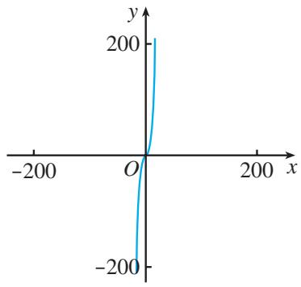
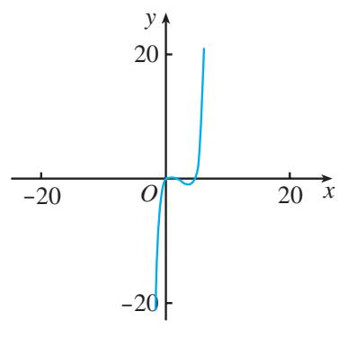
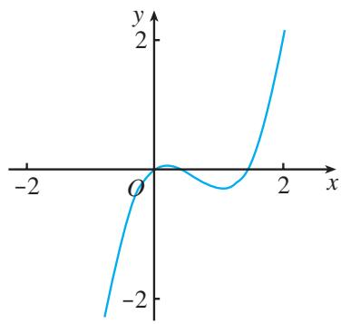

# 练习 1

1. 图（1）(2)(3) 分别为函数 $y = f(x)$ 在三个不同范围的图象。能否仅根据其中一个图象，得出函数 $y = f(x)$ 在某个区间只有一个零点的判断？为什么？

  
(1)

  
(2)  
(第1题)

  
(3)

## 解析

本来源未提供本题解析。

## 本节相关知识（范围关联）

- [函数的零点与方程的解](eab18c0bc30b141cc574f055.md)
- [函数零点存在定理](ac36d7d675bedfc384d87273.md)

## 所属组织

- [4.5.1 函数的零点与方程的解](634b5cc92999ea619eff5ef2.md)
