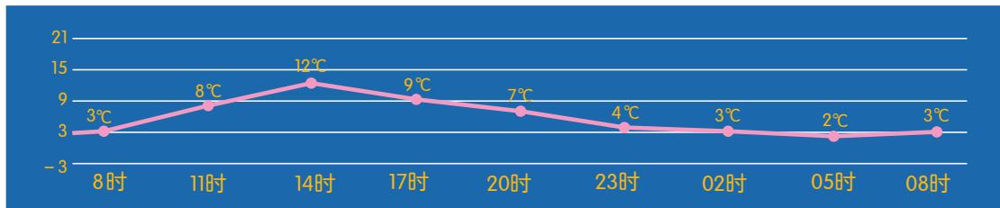

# 练习 2

2. 某日 8 时至次日 8 时（次日的时间前加 0 表示）某市的温度走势如图所示.

（1）求对应关系为图中曲线的函数的定义域与值域；

(2) 根据图象，求这一天 12 时所对应的温度.

  
(第2题)

## 解析

本来源未提供本题解析。

## 本节相关知识（范围关联）

- [函数的概念](e168e67a14a1e592576457b6.md)
- [函数相等的判定](78f29ddb08dd4175dc9c34f0.md)
- [区间](30cea9657253fa1465e5707a.md)

## 所属组织

- [3.1.1 函数的概念](be18375f919291d93af9ecb8.md)
