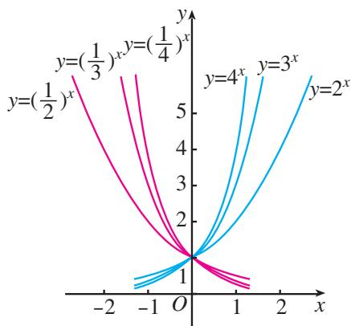
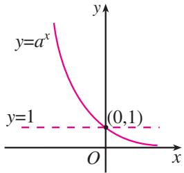
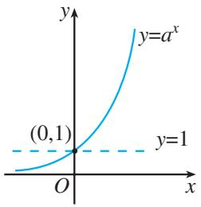

# 4.2.2 指数函数的图象和性质·探究

探究

选取底数 $a(a > 0$ ，且 $a \neq 1)$ 的若干个不同的值，在同一直角坐标系内画出相应的指数函数的图象。观察这些图象的位置、公共点和变化趋势，它们有哪些共性？由此你能概括出指数函数 $y = a^x (a > 0$ ，且 $a \neq 1)$ 的值域和性质吗？

如图4.2-6，选取底数 $a$ 的若干值，用信息技术画图，发现指数函数 $y = a^x$ 的图象按底数 $a$ 的取值，可分为 $0 < a < 1$ 和 $a > 1$ 两种类型。因此，指数函数的性质也可以分 $0 < a < 1$ 和 $a > 1$ 两种情况进行研究。

一般地，指数函数的图象和性质如表 4.2-3 所示.

表4.2-3  
  
图4.2-6

<table><tr><td>项目</td><td>01</td><td>a&gt;1</td></tr><tr><td>图象</td><td></td><td></td></tr><tr><td>定义域</td><td colspan="2">R</td></tr><tr><td>值域</td><td colspan="2">(0,+∞)</td></tr><tr><td rowspan="2">性质</td><td colspan="2">(1)过定点(0,1),即x=0时,y=1</td></tr><tr><td>(2)减函数</td><td>(2)增函数</td></tr></table>

## 引出的知识

- [指数函数的图象和性质](9bb73c42f2545c4b78854887.md)

## 本节相关知识（范围关联）

- [指数函数的图象和性质](9bb73c42f2545c4b78854887.md)

## 所属组织

- [4.2.2 指数函数的图象和性质](87b17339f3efec363df0678f.md)
