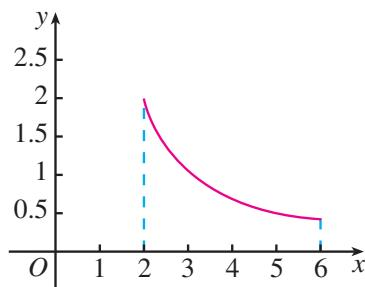

# 求区间上函数的最值·解析

对应题目：[求区间上函数的最值](b2ea54c251b02b4d0a04c45c.md)

分析：由函数 $f(x) = \frac{2}{x - 1} (x \in [2,6])$ 的图象（图3.2-5）可知，函数 $f(x) = \frac{2}{x - 1}$ 在区间[2，6]上单调递减。所以，函数 $f(x) = \frac{2}{x - 1}$ 在区间[2，6]的两个端点上分别取得最大值和最小值。

  
图3.2-5

解： $\forall x_{1},x_{2}\in [2,6]$ ，且 $x_{1} <   x_{2}$ ，则

$$
\begin{array}{r l} f (x _ {1}) - f (x _ {2}) & = \frac {2}{x _ {1} - 1} - \frac {2}{x _ {2} - 1} \\ & = \frac {2 [ (x _ {2} - 1) - (x _ {1} - 1) ]}{(x _ {1} - 1) (x _ {2} - 1)} \\ & = \frac {2 (x _ {2} - x _ {1})}{(x _ {1} - 1) (x _ {2} - 1)}. \end{array}
$$

由 $2 \leqslant x_{1} < x_{2} \leqslant 6$ ，得 $x_{2} - x_{1} > 0$ ， $(x_{1} - 1)(x_{2} - 1) > 0$ ，于是

$$
f (x _ {1}) - f (x _ {2}) > 0,
$$

即

$$
f (x _ {1}) > f (x _ {2}).
$$

所以，函数 $f(x) = \frac{2}{x - 1}$ 在区间[2，6]上单调递减.

因此，函数 $f(x) = \frac{2}{x - 1}$ 在区间[2，6]的两个端点上分别取得最大值与最小值。在 $x = 2$ 时取得最大值，最大值是2；在 $x = 6$ 时取得最小值，最小值是0.4。

## 所属组织

- [3.2.1 单调性与最大（小）值](579a9421519702a88a2259af.md)
