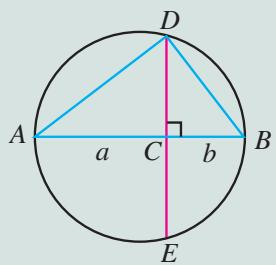

# 2.2 基本不等式·探究

探究

在图 2.2-1 中，AB 是圆的直径，点 C 是 AB 上一点，AC=a，BC=b。过点 C 作垂直于 AB 的弦 DE，连接 AD，BD。你能利用这个图形，得出基本不等式的几何解释吗？

  
图2.2-1

如图2.2-1，可证 $\triangle ACD\sim \triangle DCB$ ，因而 $CD = \sqrt{ab}$ ．由于 $CD$ 小于或等于圆的半径，用不等式表示为

$$
\sqrt {a b} \leqslant \frac {a + b}{2}.
$$

显然，当且仅当点 C 与圆心重合，即当 a=b 时，上述不等式的等号成立.

## 本节相关知识（范围关联）

- [2.2 基本不等式·核心概念](d051ed966e1ba04623d31922.md)

## 所属组织

- [2.2 基本不等式](5b180cebd4c8de7c090ed4a0.md)
