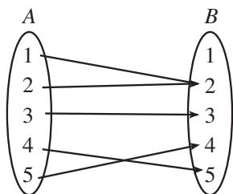

# 函数概念练习

3. 集合 $A, B$ 与对应关系 $f$ 如下图所示：

  
(第3题)

$f: A \to B$ 是否为从集合 $A$ 到集合 $B$ 的函数？如果是，那么定义域、值域与对应关系各是什么？4. 构建一个问题情境，使其中的变量关系能用解析式 $y = \sqrt{x}$ 来描述.

## 解析

本来源未提供本题解析。

## 本节相关知识（范围关联）

- [函数的概念](e168e67a14a1e592576457b6.md)
- [函数相等的判定](78f29ddb08dd4175dc9c34f0.md)
- [区间](30cea9657253fa1465e5707a.md)

## 所属组织

- [3.1.1 函数的概念](be18375f919291d93af9ecb8.md)
