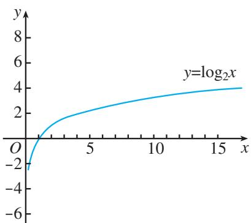

# 4.4.2 对数函数的图象和性质·核心概念

## 情境引入与思考

## 知识讲解

与研究指数函数一样，我们首先画出其图象，然后借助图象研究其性质.

不妨先画函数 $y=\log_{2}x$ 的图象.

请同学们完成 $x$ ， $y$ 的对应值表4.4-1，并用描点法画出函数 $y = \log_2x$ 的图象（图4.4-2).

表4.4-1

<table><tr><td>x</td><td>y</td></tr><tr><td>0.5</td><td>-1</td></tr><tr><td>1</td><td>0</td></tr><tr><td>2</td><td>1</td></tr><tr><td>4</td><td></td></tr><tr><td>6</td><td></td></tr><tr><td>8</td><td></td></tr><tr><td>12</td><td></td></tr><tr><td>16</td><td></td></tr></table>

  
图4.4-2

## 本节例题与练习

- [例 3 比较下列各题中两个值的大小:](7535afe7f75462f6ca0fcb64.md)
- [例 4 溶液酸碱度的测量.](f78b85ddfbe9015335284a24.md)
- [练习 1](5d7dd50cdd1470eaef2a55a7.md)
- [练习 2](ac1f4dcde59a64a33beff3e8.md)
- [练习 3](c89e4d29f6fb9a657aac0627.md)

## 所属组织

- [4.4.2 对数函数的图象和性质](bd6f4b4b8436571f683e2b1f.md)

## 相关练习组织（范围关联）

- [4.4.2 对数函数的图象和性质](cf78384877f19270153d96fe.md)
