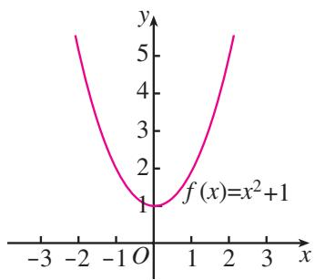
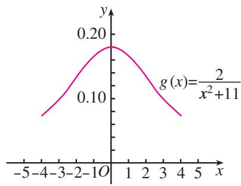

# 偶函数

## 情境引入与思考

## 知识讲解

## 定义摘录（来源原文）

一般地，设函数 $f(x)$ 的定义域为 $D$ ，如果 $\forall x \in D$ ，都有 $-x \in D$ ，且 $f(-x) = f(x)$ ，那么函数 $f(x)$ 就叫做偶函数（even function）.

例如，函数 $f(x) = x^{2} + 1$ ， $g(x) = \frac{2}{x^2 + 11}$ 都是偶函数，它们的图象分别如图3.2-7(1)(2）所示.

  
(1)

  
(2)  
图3.2-7

## 先修知识

- [函数的概念](e168e67a14a1e592576457b6.md)

## 本节例题与练习

- [例 6 判断下列函数的奇偶性：](f5ce6138d36cd67fa12d213c.md)
- [练习 1](8da51fd463e40df45326eb07.md)
- [练习 2](08fe8b20a036335f1bbf067d.md)

## 所属组织

- [3.2.2 奇偶性](a3ecc2aade2f5ea42bf9965b.md)

## 相关练习组织（范围关联）

- [3.2.2 奇偶性](e325daab55801c969b6b77af.md)
