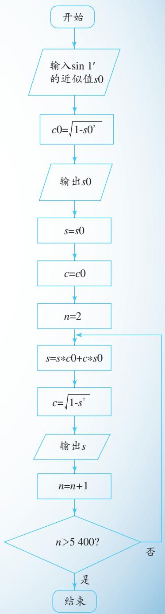

# 利用信息技术制作三角函数表

前面在“对数的发明”中曾经谈到，纳皮尔利用对数制作了 $0^{\circ} \sim 90^{\circ}$ 每隔 $1'$ 的八位三角函数表。应当说，纳皮尔仅仅凭借手工运算得到这个三角函数表的工作量是非常大的，这也显示出他超人的毅力和为科学献身的精神。今天，我们可以利用已经学会的三角函数知识以及算法知识，借助信息技术，容易地制作出非常精确的三角函数表。下面我们借助信息技术来作一个 $0^{\circ} \sim 90^{\circ}$ 每隔 $1'$ 的八位三角函数表。

用计算工具可得：

$\sin 1^{\prime}\approx 2.908882046\times 10^{-4}\\ \approx 0.000290888.$

以此作为初始值，利用

$$
\begin{array}{c} \cos 1 ^ {\prime} = \sqrt {1 - \sin^ {2} 1 ^ {\prime}}; \\ \alpha_ {0} = 1 ^ {\prime}, \alpha_ {n} = \alpha_ {n - 1} + 1 ^ {\prime}, n \geqslant 1; \\ \sin \alpha_ {n} = \sin 1 ^ {\prime} \cos \alpha_ {n - 1} + \cos 1 ^ {\prime} \sin \alpha_ {n - 1}, \\ \cos \alpha_ {n} = \sqrt {1 - \sin^ {2} \alpha_ {n}}, \end{array}
$$

就可以写出一个程序框图（如右图所示），然后通过信息技术得到一个正弦函数的三角函数表.

请同学们根据上述思路，自己编写程序，得出一个三角函数表.

## 本节例题与练习

- [习题5.5 复习巩固 第10题](6ee56b5a51ad95d7b617e5a6.md)
- [习题5.5 复习巩固 第11题](243e1ce570fbd2dedf20a78e.md)
- [习题5.5 复习巩固 第11题](84e5ade74a32bc8886bcd979.md)
- [习题5.5 复习巩固 第12题](0caf8b8d66509ac0de935f57.md)
- [习题5.5 复习巩固 第1题](70c82bbb8429ead5ff25c55a.md)
- [习题5.5 复习巩固 第2题](a7a58f59a45b9e8dab5e953d.md)
- [习题5.5 复习巩固 第3题](ba9856a71177cde601185114.md)
- [习题5.5 复习巩固 第4题](54c3324d90018dde37d459b7.md)
- [习题5.5 复习巩固 第5题](d11113a84a52b8acf129faeb.md)
- [习题5.5 复习巩固 第7题](db6b2fdb0a35ffabe0961ee8.md)
- [习题5.5 复习巩固 第8题](8fae498f3cfdbb9437c300db.md)
- [习题5.5 复习巩固 第9题](96d1534e521e3bcb59c2706e.md)
- [习题5.5 拓广探索 第18题](9b67b4ea44efeb9e46d4c22b.md)
- [习题5.5 拓广探索 第19题](160bae70e522c26cabcbb0bd.md)
- [习题5.5 拓广探索 第20题](d7eed29045ac5c9be11b2755.md)
- [习题5.5 综合运用 第13题](30b427a50114a395b5ecfde3.md)
- [习题5.5 综合运用 第14题](c081b946bd1c5a5a47f183af.md)
- [习题5.5 综合运用 第15题](5a1942722bc1576bfbd41f51.md)
- [习题5.5 综合运用 第16题](938f8116a860cedeb05a7980.md)

## 所属组织

- [信息技术应用 利用信息技术制作三角函数表](d4511b4f2aaf1a1e96abcb2e.md)

## 相关练习组织（范围关联）

- [信息技术应用 利用信息技术制作三角函数表](9f2a0986923bb3c7047f2731.md)
