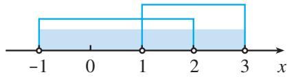

# 例 2 设集合 $A=\{x \mid·解析

对应题目：[例 2 设集合 $A=\{x \mid](../Q13439021260984025191.md)

解： $A\cup B = \{x\mid -1 <   x <   2\} \cup \{x\mid 1 <   x <   3\}$ $= \{x\mid -1 <   x <   3\} .$

如图 1.3-2，还可以利用数轴直观表示例 2 中求并集 $A \cup B$ 的过程.

  
图1.3-2

## 所属组织

- [1.3 集合的基本运算](4787c0acf3f5fcca91cca083.md)
