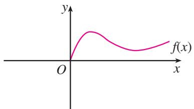
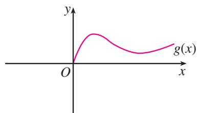

# 练习 1

1. 已知 $f(x)$ 是偶函数， $g(x)$ 是奇函数，试将下图补充完整.

  
(第1题)

## 解析

本来源未提供本题解析。

## 本节相关知识（范围关联）

- [偶函数](7d7d586e0d745b68b56a5671.md)
- [奇函数](acf246e7e23b68059c0fc330.md)

## 所属组织

- [3.2.2 奇偶性](e325daab55801c969b6b77af.md)
