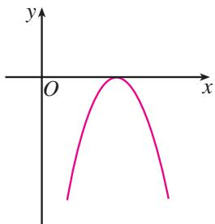
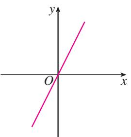
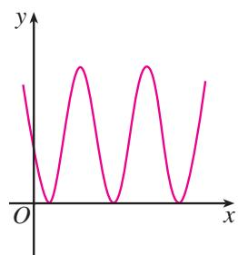
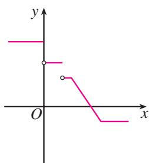

# 习题4.5 复习巩固 第1题

1. 下列函数图象与 $x$ 轴均有交点，其中不能用二分法求其零点的是\_\_\_\_。（填写上所有符合条件的图号）

①

②

③

  
④

## 解析

本来源未提供本题解析。

## 本节相关知识（范围关联）

- [中外历史上的方程求解](a4f335a906257ef9dbfcb5d6.md)

## 所属组织

- [习题4.5](4aac3af86c150127e395b319.md)
