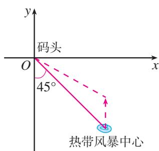

# 习题2.3 拓广探索 第6题

6. 如图，据气象部门预报，在距离某码头南偏东 $45^{\circ}$ 方向 $600\mathrm{km}$ 处的热带风暴中心正以 $20\mathrm{km / h}$ 的速度向正北方向移动，距风暴中心 $450\mathrm{km}$ 以内的地区都将受到影响。据以上预报估计，从现在起多长时间后，该码头将受到热带风暴的影响，影响时间大约为多长（精确到 $0.1\mathrm{h}$ ）？

  
(第6题)

## 解析

本来源未提供本题解析。

## 本节相关知识（范围关联）

- [二次函数与一元二次不等式](ef6af1c04ed7175085b8ab88.md)

## 所属组织

- [习题2.3](312169b0c725a6c429949b14.md)
