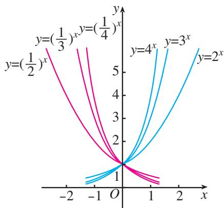
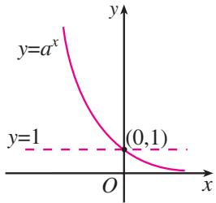
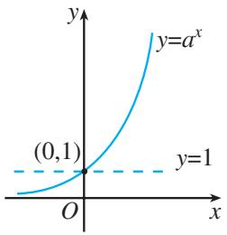

# 指数函数的图象和性质

## 情境引入与思考

## 知识讲解

## 定义摘录（来源原文）

一般地，指数函数的图象和性质如表 4.2-3 所示.

表4.2-3  
  
图4.2-6

<table><tr><td>项目</td><td>01</td><td>a&gt;1</td></tr><tr><td>图象</td><td></td><td></td></tr><tr><td>定义域</td><td colspan="2">R</td></tr><tr><td>值域</td><td colspan="2">(0,+∞)</td></tr><tr><td rowspan="2">性质</td><td colspan="2">(1)过定点(0,1),即x=0时,y=1</td></tr><tr><td>(2)减函数</td><td>(2)增函数</td></tr></table>

## 先修知识

- [指数函数的概念](02fdbecb17b8434368768de0.md)

## 本节例题与练习

- [例 3 比较下列各题中两个值的大小:](6c3de62bc2e2e8d71df48ac6.md)
- [例 4 如图 4.2-7](16060b7ae35eb5166c2c67c1.md)
- [练习 1](f93b73380b841efbf807ed2f.md)
- [练习 2](389d7cac29f8815851745ccb.md)
- [练习 3](fd4391a8cb62c6d0fca4b38a.md)

## 所属组织

- [4.2.2 指数函数的图象和性质](297449082718303b76d37769.md)

## 相关练习组织（范围关联）

- [4.2.2 指数函数的图象和性质](314b59d71d07d23b482cadb3.md)
