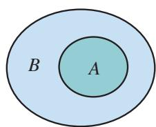

# 1.2 集合间的基本关系·观察

> [!question] 观察
> 观察下面几个例子，类比实数之间的相等关系、大小关系，你能发现下面两个集合之间的关系吗？
>
> (1) $A = \{1, 2, 3\}$ , $B = \{1, 2, 3, 4, 5\}$ ;
>
> （2） $C$ 为立德中学高一（2）班全体女生组成的集合， $D$ 为这个班全体学生组成的集合；
>
> (3) $E = \{x \mid x \text{ 是有两条边相等的三角形}\}$ , $F = \{x \mid x \text{ 是等腰三角形}\}$ .

可以发现，在（1）中，集合 A 的任何一个元素都是集合 B 的元素．这时我们说集合 A 包含于集合 B，或集合 B 包含集合 A．（2）中的集合 C 与集合 D 也有这种关系.

一般地，对于两个集合 A，B，如果集合 A 中任意一个元素都是集合 B 中的元素，就称集合 A 为集合 B 的子集 (subset)，记作

$$
A \subseteq B (\text {或} B \supseteq A),
$$

读作 “A 包含于 B”（或 “B 包含 A”）.

在数学中，我们经常用平面上封闭曲线的内部代表集合，这种图称为Venn图．这样，上述集合 $A$ 与集合 $B$ 的包含关系，可以用图1.2-1表示.

图1.2-1

在（3）中，由于“两条边相等的三角形”是等腰三角形，因此，集合 $E$ ， $F$ 都是由所有等腰三角形组成的集合.即集合 $E$ 中任何一个元素都是集合 $F$ 中的元素，同时，集合 $F$ 中任何一个元素也都是集合 $E$ 中的元素．这样，集合 $E$ 的元素与集合 $F$ 的元素是一样的.

一般地，如果集合 A 的任何一个元素都是集合 B 的元素，同时集合 B 的任何一个元素都是集合 A 的元素，那么集合 A 与集合 B 相等，记作 A=B .

请你举出几个具有包含关系、相等关系的集合实例.

也就是说，若 $A \subseteq B$ ，且 $B \subseteq A$ ，则 $A = B$ .

如果集合 $A \subseteq B$ ，但存在元素 $x \in B$ ，且 $x \notin A$ ，就称集合 $A$ 是集合 $B$ 的真子集（proper subset），记作

$$
A \subsetneqq B (\text {或} B \supsetneqq A),
$$

与实数中的结论“若 $a \geqslant b$ ，且 $b \geqslant a$ ，则 $a = b$ ”相类比，你有什么体会？

读作 “A 真包含于 B”（或 “B 真包含 A”）.

例如，在（1）中， $A \subseteq B$ ，但 $4 \in B$ ，且 $4 \notin A$ ，所以集合 A 是集合 B 的真子集.

我们知道，方程 $x^{2} + 1 = 0$ 没有实数根，所以方程 $x^{2} + 1 = 0$ 的实数根组成的集合中没有元素.

你能举出几个空集的例子吗？

一般地，我们把不含任何元素的集合叫做空集（empty set），记为 $\varnothing$ ，并规定：空集是任何集合的子集.

## 引出的知识

- [集合间的基本关系](2ad24c88facb1a120ea29e58.md)

## 本节相关知识（范围关联）

- [集合间的基本关系](2ad24c88facb1a120ea29e58.md)

## 所属组织

- [1.2 集合间的基本关系](0db811c34180a06f5cf479eb.md)
