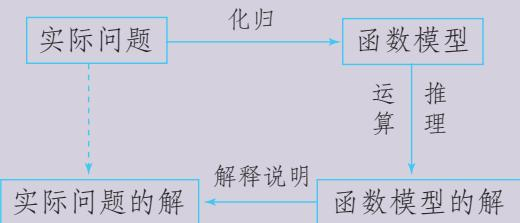

# 用函数建模的基本过程

## 情境引入与思考

## 知识讲解

用函数建立数学模型解决实际问题的基本过程如下：

这一过程包括分析和理解实际问题的增长情况（是“对数增长”“直线上升”还是“指数爆炸”）；根据增长情况选择函数类型构建数学模型，将实际问题化归为数学问题；通过运算、推理求解函数模型；用得到的函数模型描述实际问题的变化规律，解决有关问题。在这一过程中，往往需要利用信息技术帮助画图、运算等。

## 本节例题与练习

- [例 3 人口问题是当今世界各国普遍关注](10117fe1f28e82723b4567d6.md)
- [例 4 2010 年](d1a01c0fb961c9189eb4bc80.md)
- [比较三种投资方案](10af24aeafb36bf79833d912.md)
- [碳14与年代测定练习](2d99d3ac935f8b03a19f3283.md)
- [练习 1](c8e166a6898c23b80770efa2.md)
- [练习 1](ae1fad99843f5aaa9465385c.md)
- [练习 2](8c6847ebdd18d06ae5b48a1d.md)
- [练习 2](7ea5aee9a75a17a95f875afb.md)
- [销售奖励的函数模型](9391a5f85df8cea394a3d3ff.md)

## 所属组织

- [4.5.3 函数模型的应用](4228d62b46be53f82bab7483.md)

## 相关练习组织（范围关联）

- [4.5.3 函数模型的应用](08e317694fc36a87546aa4da.md)
