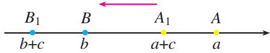

# 不等式的基本性质

## 情境引入与思考

## 知识讲解

探究

类比等式的基本性质，你能猜想不等式的基本性质，并加以证明吗？

类比等式的性质 1，2，可以猜想不等式有如下性质：

性质 1 如果 a > b，那么 b < a；如果 b < a，那么 a > b。即

$$
a > b \Leftrightarrow b <   a.
$$

性质2 如果 $a > b$ ， $b > c$ ，那么 $a > c$ .即

$$
a > b, b > c \Rightarrow a > c.
$$

我们来证明性质2：

由两个实数大小关系的基本事实知

$$
\begin{array}{r l} & a > b \Rightarrow a - b > 0 \\ & b > c \Rightarrow b - c > 0 \end{array} \Rightarrow (a - b) + (b - c) > 0 \Rightarrow a - c > 0 \Rightarrow a > c.
$$

类比等式的性质 3～5，可以猜想不等式还有如下性质：

性质3 如果 $a > b$ ，那么 $a + c > b + c$

这就是说，不等式的两边都加上同一个实数，所得不等式与原不等式同向.

从不同角度表述不等式的性质，可以加深理解。对其他不等式的性质，你能用文字语言表述吗？

如图 2.1-5，把数轴上的两个点 A 与 B 同时沿相同方向移动相等的距离，得到另两个点 $A_{1}$ 与 $B_{1}$ ，A 与 B 和 $A_{1}$ 与 $B_{1}$ 的左右位置关系不会改变。用不等式的语言表示，就是上述性质 3。

<table><tr><td>B</td><td> $B_1$ </td><td>A</td><td> $A_1$ </td></tr><tr><td>b</td><td>b+c</td><td>a</td><td>a+c</td></tr></table>

  
图2.1-5

由性质3可得，

$$
\begin{array}{r l} a + b > c & \Rightarrow a + b + (- b) > c + (- b) \\ & \Rightarrow a > c - b. \end{array}
$$

这表明，不等式中任何一项可以改变符号后移到不等号的另一边.

性质 4 如果 a > b，c > 0，那么 ac > bc；如果 a > b，c < 0，那么 ac < bc。

这就是说，不等式两边同乘一个正数，所得不等式与原不等式同向；不等式两边同乘一个负数，所得不等式与原不等式反向.

利用这些基本性质，我们还可以推导出其他一些常用的不等式的性质。例如，利用性质2，3可以推出：

性质 5 如果 a > b，c > d，那么 $a + c > b + d$ .

事实上，由 $a > b$ 和性质3，得 $a + c > b + c$ ；由 $c > d$ 和性质3，得 $b + c > b + d$ 。再

根据性质2，即得 $a + c > b + d$

利用性质 4 和性质 2 可以推出：

性质 6 如果 a > b > 0，c > d > 0，那么 ac > bd.

性质 7 如果 a > b > 0，那么 $a^{n} > b^{n}$ ( $n \in N, n \geqslant 2$ ).

实数大小关系的基本事实和不等式的性质是解决不等式问题的基本依据.

## 本节例题与练习

- [习题2.1 复习巩固 第1题](84ee26a07e11a2fafae9afa7.md)
- [习题2.1 复习巩固 第2题](9ed2dfd4953fd6971af5956b.md)
- [习题2.1 复习巩固 第3题](bf1f4df35296f744f54836db.md)
- [习题2.1 复习巩固 第4题](b999e93599c334da0ac857f9.md)
- [习题2.1 复习巩固 第5题](fac137fabcb28a098ef85e2d.md)
- [习题2.1 复习巩固 第6题](48d2bfe307f309b1e5419e0c.md)
- [习题2.1 拓广探索 第11题](df93d0bab9a29266aaf96dec.md)
- [习题2.1 拓广探索 第12题](1a4a1dcebf7c7ea9c7678508.md)
- [习题2.1 综合运用 第10题](deccb7abf13067988f867824.md)
- [习题2.1 综合运用 第7题](7ad4b7203dc7ed0d196d6cae.md)
- [习题2.1 综合运用 第8题](98fdc80562b942cd6a573aac.md)
- [习题2.1 综合运用 第9题](4f8d93ac3cd085e6c63b44a6.md)
- [例 1 比较 $(x+2)(x+3)$](../%E4%B9%A0%E9%A2%98/Q18286620196856027016.md)
- [利用不等式性质证明不等式](14ff32ebf076c10725ca2216.md)
- [比较不等式练习](5e2c9293e4f8a1a49e2133e2.md)
- [练习 1](1836d2754050169c2421551e.md)
- [练习 1](7fd43d0d4ebc4b9c21fca909.md)
- [练习 2](3e7680bf85dec1460cee1687.md)
- [练习 2](358b0f3b5058b1d11f7a8b20.md)

## 所属组织

- [2.1 等式性质与不等式性质](158c5b2ee30e046daa521f8c.md)

## 相关练习组织（范围关联）

- [2.1 等式性质与不等式性质](2fdf2a7e022452cb28aed5d2.md)
