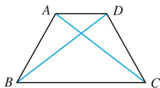

# 练习 1

1. 下列各题中，哪些 $p$ 是 $q$ 的充要条件？

(1) p：三角形为等腰三角形，q：三角形存在两角相等；

(2) $p: \odot O$ 内两条弦相等, $q: \odot O$ 内两条弦所对的圆周角相等;

(3) $p: A \cap B$ 为空集, $q: A$ 与 $B$ 之一为空集.

## 解析

本来源未提供本题解析。

## 本节相关知识（范围关联）

- [充要条件](8dc3bfd9059f5f995308930b.md)
- [平行四边形的充要条件](13e8286020c30a2f9fd6b4d9.md)

## 所属组织

- [1.4.2 充要条件](2f1122c9b630646c583738df.md)
