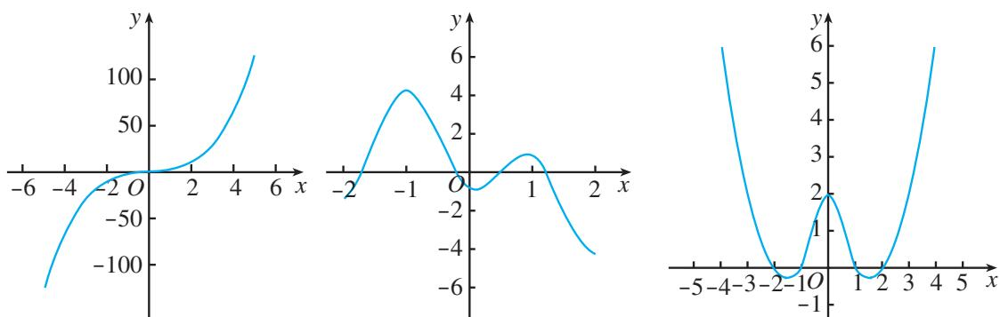

# 3.2 函数的基本性质·本节导语

变化中的不变性就是性质，变化中的规律性也是性质.

前面学习了函数的定义和表示法，知道函数 $y=f(x)$ $(x\in A)$ 描述了客观世界中变量之间的一种对应关系。这样，我们就可以通过研究函数的变化规律来把握客观世界中事物的变化规律。因此，研究函数的性质，如随着自变量的增大函数值是增大还是减小，有没有最大值或最小值，函数图象有什么特征等，是认识客观规律的重要方法。

我们知道，先画出函数图象，通过观察和分析图象的特征，可以得到函数的一些性质．观察图3.2-1中的各个函数图象，你能说说它们分别反映了相应函数的哪些性质吗？

  
图3.2-1

## 所属组织

- [3.2 函数的基本性质](81a14a53c1f682ba8537ca83.md)
