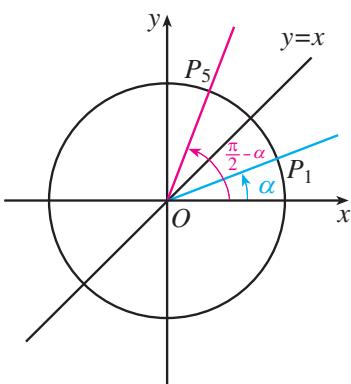

# 诱导公式五与公式六

## 情境引入与思考

## 知识讲解

下面在探究 1 的基础上继续探究.

作 $P_{1}$ 关于直线 $y = x$ 的对称点 $P_{5}$ ，以 $OP_{5}$ 为终边的角 $\gamma$ 与角 $\alpha$ 有什么关系？角 $\gamma$ 与角 $\alpha$ 的三角函数值之间有什么关系？

如图5.3-5，以 $OP_{5}$ 为终边的角 $\gamma$ 都是与角 $\frac{\pi}{2} -\alpha$ 终边相同的角，即 $\gamma = 2k\pi +\left(\frac{\pi}{2} -\alpha\right)$ $(k\in \mathbf{Z})$ ，因此，只要探究角 $\frac{\pi}{2} -\alpha$ 与 $\alpha$ 的三角函数值之间的关系即可.

设 $P_{5}(x_{5},y_{5})$ ，由于 $P_{5}$ 是点 $P_{1}$ 关于直线 $y = x$ 的对称点，可以证明

$$
x _ {5} = y _ {1}, \quad y _ {5} = x _ {1}.\tag{①}
$$

根据三角函数的定义，得

$$
\sin \left(\frac {\pi}{2} - \alpha\right) = y _ {5}, \cos \left(\frac {\pi}{2} - \alpha\right) = x _ {5}.
$$

从而得

公式五

图5.3-5

$$
\sin \left(\frac {\pi}{2} - \alpha\right) = \cos \alpha ,
$$

$$
\cos \left(\frac {\pi}{2} - \alpha\right) = \sin \alpha .
$$

?

你能利用平面几何的知识，就图5.3-5所示的情况证明①式吗？其他情况呢？

作 $P_{5}$ 关于 $y$ 轴的对称点，又能得到什么结论？

类似地，可得

公式六

$$
\sin \left(\frac {\pi}{2} + \alpha\right) = \cos \alpha ,
$$

$$
\cos \left(\frac {\pi}{2} + \alpha\right) = - \sin \alpha .
$$

角 $\frac{\pi}{2} + \alpha$ 的终边与角 $\alpha$ 的终边具有怎样的对称性？据此你将如何证明公式六？

利用公式五或公式六，可以实现正弦函数与余弦函数的相互转化.

公式一～公式六都叫做诱导公式.

## 本节例题与练习

- [三角函数值填表练习](951b7a44c64de13100433f0b.md)
- [习题5.3 复习巩固 第1题](42cd95277b7a6772fd05cb7b.md)
- [习题5.3 复习巩固 第2题](84a60f35501b3a963271f909.md)
- [习题5.3 复习巩固 第3题](44ea5c650c4c232df671fb35.md)
- [习题5.3 复习巩固 第4题](a80887615eb4b2bcdc92fe87.md)
- [习题5.3 拓广探索 第10题](eb4931408b99e800d94217bf.md)
- [习题5.3 拓广探索 第9题](49297de8678a4f591e2345d4.md)
- [习题5.3 综合运用 第5题](6c8686b157530c536ad52281.md)
- [习题5.3 综合运用 第6题](db5ab12b9af01b69ce85b5f6.md)
- [习题5.3 综合运用 第7题](120460981649ce33b1ba6954.md)
- [习题5.3 综合运用 第8题](d089d0021d42a06ed14f54b0.md)
- [例 1 利用公式求下列三角函数值：](5a4472cd7a6a07f44afb808e.md)
- [例 2 化简](1b5e610416e7a7cb69919e3b.md)
- [利用诱导公式化简](a1d5f36e0b3b4d72c0ae1ac3.md)
- [已知角关系求正弦值](6b3f059a0657a50b1b4ada26.md)
- [练习 1](2c8db3ff2a2b5ad350f13eb1.md)
- [练习 1](f159e485787427e4c97da53b.md)
- [练习 2](5ed21b61d4e969cbc3875027.md)
- [练习 2](1e7faaa950c3e3bd8567839f.md)
- [练习 3](d10272f6cd3b9a1160f81f84.md)
- [证明诱导公式](cfd05be7776a243513bae0db.md)

## 所属组织

- [5.3 诱导公式](1735c72ff2b44a857835dd81.md)

## 相关练习组织（范围关联）

- [5.3 诱导公式](7b0eb16aadf3bc46be566a97.md)
