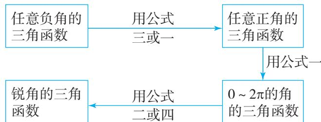

# 5.3 诱导公式·思考

思考

由例 1，你对公式一～公式四的作用有什么进一步的认识？你能自己归纳一下把任意角的三角函数转化为锐角三角函数的步骤吗？

利用公式一～公式四，可以把任意角的三角函数转化为锐角三角函数，一般可按下面步骤进行：

数学史上，求三角函数值曾经是一个重要而困难的问题。数学家制作了锐角三角函数表，并通过公式一～公式四，按上述步骤解决了问题。现在，我们可以利用计算工具方便地求任意角的三角函数值，所以这些公式的“求值”作用已经不重要了，但它们所体现的三角函数的对称性，在解决三角函数的各种问题中却依然有重要的作用。

## 本节相关知识（范围关联）

- [诱导公式二、三、四](2c242117e94bebe53c739d4c.md)
- [诱导公式五与公式六](bcb8af8b818c4486b16031f9.md)

## 所属组织

- [5.3 诱导公式](9b15246548478c19ccdb8762.md)
