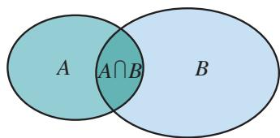

# 交集

## 情境引入与思考

## 知识讲解

## 定义摘录（来源原文）

一般地，由所有属于集合 A 且属于集合 B 的元素组成的集合，称为集合 A 与 B 的交集（intersection set），记作 $A \cap B$ （读作 “A 交 B”），即

$$
A \cap B = \{x \mid x \in A, \text {且} x \in B \},
$$

  
图1.3-3

可用 Venn 图（图 1.3-3）表示.

这样，在上述问题(1)(2)中， $A \cap B = C$ .

## 先修知识

- [集合与元素](5a233bacf14400474307d62d.md)

## 本节例题与练习

- [习题 1.3 复习巩固 第1题](a739fab6a322fec49ef90408.md)
- [习题 1.3 复习巩固 第2题](e7180e047bed16fa5a1a1834.md)
- [习题 1.3 复习巩固 第3题](d2eaa85a391d21b78e970ece.md)
- [习题 1.3 拓广探索 第6题](116309a9b8db0f9b71be8228.md)
- [习题 1.3 综合运用 第4题](d7161accc4984146dcf40f51.md)
- [习题 1.3 综合运用 第5题](66260634da9de03155c4c697.md)
- [例 1 设 $A=\{4, 5, 6,](../%E4%B9%A0%E9%A2%98/Q18022349803527100922.md)
- [例 2 设集合 $A=\{x \mid](../%E4%B9%A0%E9%A2%98/Q13439021260984025191.md)
- [用集合交集表示两直线的位置关系](816467d5ee8ce82394380560.md)
- [练习 1](ecde1b56f3170e11dc907c0f.md)
- [练习 1](6df8261b3d6e655c07872e9a.md)
- [练习 2](e36222e1c0c6258506a1f23c.md)
- [练习 2](22548c910660b49e9e8b0132.md)
- [练习 3](d208f476d1ab2eda0bdc0799.md)
- [练习 3](f92d09e07eeef0d41dff54cd.md)
- [补集例5](e33d7a4d135cf1b842d0fbfb.md)
- [集合交集：参加两项比赛的同学](93c4c9fc04d69d15d65731cb.md)
- [集合运算例6](7305fa54c2dac123ae8c1fae.md)
- [集合运算练习](22b45d055b9baf58feaac02b.md)

## 所属组织

- [1.3 集合的基本运算](297a6503716d62725a4315b6.md)

## 相关练习组织（范围关联）

- [1.3 集合的基本运算](4787c0acf3f5fcca91cca083.md)
