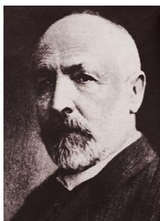

# 习题1.1 拓广探索 第5题

5. 集合论是德国数学家康托尔于 19 世纪末创立的。当时，康托尔在解决涉及无限量研究的数学问题时，越过“数集”限制，提出了一般性的“集合”概念。关于集合论，希尔伯特赞誉其为“数学思想的惊人的产物，在纯粹理性的范畴中人类活动的最美的表现之一”，罗素描述其为“可能是这个时代所能夸耀的最伟大的工作”。请你查阅相关资料，用简短的报告阐述你对这些评价的认识。

  
康托尔（Georg Cantor，1845—1918）

## 解析

本来源未提供本题解析。

## 本节相关知识（范围关联）

- [列举法](7e3126466b3d529ac3b9563b.md)
- [描述法](7718f7effa7d852574c850a0.md)
- [集合与元素](5a233bacf14400474307d62d.md)

## 所属组织

- [习题1.1](8cd0eb346f4a94955dd60e01.md)
