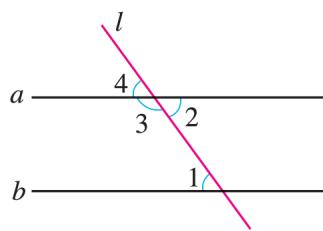

# 练习 3

3. 如图，直线 $a$ 与 $b$ 被直线 $l$ 所截，分别得到了 $\angle 1, \angle 2, \angle 3$ 和 $\angle 4$ . 请根据这些信息，写出几个 “ $a // b$ ” 的充分条件和必要条件.

  
(第3题)

## 解析

本来源未提供本题解析。

## 本节相关知识（范围关联）

- [充分条件与必要条件](20cb9b5fbbbdcfb1a6c346da.md)

## 所属组织

- [1.4.1 充分条件与必要条件](0518cdaf300ee736c76af192.md)
