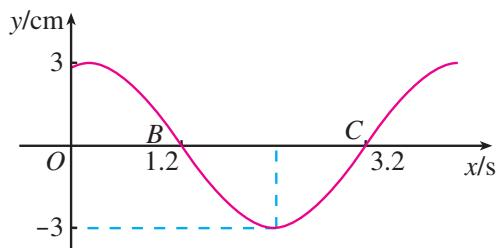
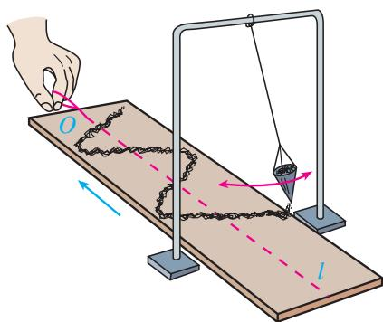

# 练习 1

1. 某简谐运动的图象如图所示，试根据图象回答下列问题：

(1) 这个简谐运动的振幅、周期与频率各是多少?

(2) 写出这个简谐运动的函数解析式.

  
(第1题)

  
(第2题)

## 解析

本来源未提供本题解析。

## 本节相关知识（范围关联）

- [三角函数模型的应用步骤](75ee85e3f5aaf3e4a982f9b1.md)

## 所属组织

- [5.7 三角函数的应用](d59dcdad7e862135ea450454.md)
