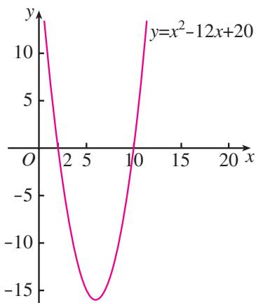
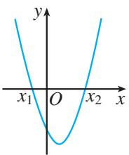
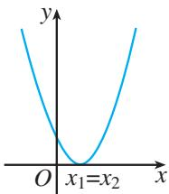
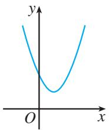

# 二次函数与一元二次不等式

## 情境引入与思考

## 知识讲解

## 定义摘录（来源原文）

一般地，对于二次函数 $y=ax^{2}+bx+c$ ，我们把使 $ax^{2}+bx+c=0$ 的实数 x 叫做二次函数 $y=ax^{2}+bx+c$ 的零点。于是，二次函数 $y=x^{2}-12x+20$ 的两个零点是 $x_{1}=2,\quad x_{2}=10$ 。

从图2.3-1可以看出，二次函数 $y = x^{2} - 12x + 20$ 的两个零点 $x_{1} = 2$ ， $x_{2} = 10$ 将 $x$ 轴分成三段。相应地，当 $x < 2$ 或 $x > 10$ 时，函数图象位于 $x$ 轴上方，此时 $y > 0$ ，即 $x^{2} - 12x + 20 > 0$ ；当 $2 < x < 10$ 时，函数图象位于 $x$ 轴下方，此时 $y < 0$ ，即 $x^{2} - 12x + 20 < 0$ 。所以，一元二次不等式 $x^{2} - 12x + 20 < 0$ 的解集是

  
图2.3-1

$$
\{x \mid 2 <   x <   1 0 \}.
$$

因为 $\{x\mid 2 <   x <   10\} \subseteq \{x\mid 0 <   x <   12\}$ ，因此当围成的矩形的一条边长 $x$ 满足 $2 <   x <   10$ 时，围成的矩形区域的面积大于 $20~\mathrm{m}^2$

上述方法可以推广到求一般的一元二次不等式 $ax^2 + bx + c > 0 (a > 0)$ 和 $ax^2 + bx + c < 0 (a > 0)$ 的解集。因为一元二次方程的根是相应一元二次函数的零点，所以先求出一元二次方程的根，再根据二次函数图象与 $x$ 轴的相关位置确定一元二次不等式的解集。

我们知道，对于一元二次方程 $ax^2 + bx + c = 0 (a > 0)$ ，设 $\Delta = b^2 - 4ac$ ，它的根按照 $\Delta > 0$ ， $\Delta = 0$ ， $\Delta < 0$ 可分为三种情况。相应地，二次函数 $y = ax^2 + bx + c (a > 0)$ 的图象与 $x$ 轴的位置关系也分为三种情况。因此，我们分三种情况来讨论对应的一元二次不等式 $ax^2 + bx + c > 0 (a > 0)$ 和 $ax^2 + bx + c < 0 (a > 0)$ 的解集（表2.3-1）。

表 2.3-1 二次函数与一元二次方程、不等式的解的对应关系

<table><tr><td>项目</td><td>$\Delta>0$</td><td>$\Delta=0$</td><td>$\Delta<0$</td></tr><tr><td>$y=ax^2+bx+c\ (a>0)$ 的图象</td><td></td><td></td><td></td></tr><tr><td>$ax^2+bx+c=0\ (a>0)$ 的根</td><td>有两个不相等的实数根 $x_1,x_2\ (x_1<x_2)$</td><td>有两个相等的实数根 $x_1=x_2=-\frac{b}{2a}$</td><td>没有实数根</td></tr><tr><td>$ax^2+bx+c>0\ (a>0)$ 的解集</td><td>$\{x\mid x<x_1\text{，或 }x>x_2\}$</td><td>$\{x\mid x\neq-\frac{b}{2a}\}$</td><td>$\mathbf{R}$</td></tr><tr><td>$ax^2+bx+c<0\ (a>0)$ 的解集</td><td>$\{x\mid x_1<x<x_2\}$</td><td>$\varnothing$</td><td>$\varnothing$</td></tr></table>

第二章 一元二次函数、方程和不等式

## 原文校核记录

- 对照教材第51页表2.3-1恢复串列、截断的根与不等式解集；重根符号同时据原文与方程核验。

## 本节例题与练习

- [一元二次不等式应用：刹车距离](ef15bb6b1ecd9c2a8d09a1b8.md)
- [一元二次不等式应用：摩托车产值](ac19a1ce3db15196e8949811.md)
- [一元二次不等式练习](d11d054dd2d64db014fde323.md)
- [习题2.3 复习巩固 第1题](c3d6458e690f88ea7a58c77f.md)
- [习题2.3 复习巩固 第2题](26ccc8106b162b3864d01edc.md)
- [习题2.3 拓广探索 第6题](9afca4dabbf0a9f6d70e2269.md)
- [习题2.3 综合运用 第3题](8e5558bffef7b51e5b624f0a.md)
- [习题2.3 综合运用 第4题](8d192963ae090b1cbf21adb6.md)
- [习题2.3 综合运用 第5题](9eb2094ae9a3e3024e94bf9a.md)
- [例 1 求不等式 $x^{2}-5x+](../%E4%B9%A0%E9%A2%98/Q14288615043798539936.md)
- [例 2 求不等式 $9x^{2}-6x](../%E4%B9%A0%E9%A2%98/Q5941478709701880117.md)
- [例 3 求不等式 $-x^{2}+2x](df982ac209d2bde85f602b89.md)
- [练习 1](4b9e46550ee3e52c8f252878.md)
- [练习 1](0dba0efaa980b732eb552507.md)
- [练习 2](f28a7f002ea02e93d7ae77a8.md)
- [练习 3](c55b018b2d7ea5c64d77a12f.md)

## 所属组织

- [2.3 二次函数与一元二次方程、不等式](9f909e1e314a2525b4de9231.md)

## 相关练习组织（范围关联）

- [2.3 二次函数与一元二次方程、不等式](61b34f4c592952b5bc592134.md)
