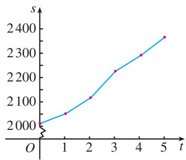

# 例 2 一辆汽车在某段路程中行驶的平均·解析

对应题目：[例 2 一辆汽车在某段路程中行驶的平均](1d8f0d68658a68fe7c94c654.md)

分析：当时间 $t$ 在 $[0, 5]$ 内变化时，对于任意的时刻 $t$ 都有唯一确定的行驶路程与之相对应。根据图3.4-1，在时间段 $[0, 1)$ ， $[1, 2)$ ， $[2, 3)$ ， $[3, 4)$ ， $[4, 5]$ 内行驶的平均速率分别为 $50 \mathrm{~km} / \mathrm{h}$ ， $80 \mathrm{~km} / \mathrm{h}$ ， $90 \mathrm{~km} / \mathrm{h}$ ， $75 \mathrm{~km} / \mathrm{h}$ ， $65 \mathrm{~km} / \mathrm{h}$ ，因此在每个时间段内，行驶路程与时间的关系也不一样，需要分段表述。

解：（1）阴影部分的面积为

$$
5 0 \times 1 + 8 0 \times 1 + 9 0 \times 1 + 7 5 \times 1 + 6 5 \times 1 = 3 6 0.
$$

阴影部分的面积表示汽车在这 5 h 内行驶的路程为 360 km.

(2) 根据图 3.4-1，有

$$
s = \left\{ \begin{array}{l} 5 0 t + 2 0 0 4, 0 \leqslant t <   1, \\ 8 0 (t - 1) + 2 0 5 4, 1 \leqslant t <   2, \\ 9 0 (t - 2) + 2 1 3 4, 2 \leqslant t <   3, \\ 7 5 (t - 3) + 2 2 2 4, 3 \leqslant t <   4, \\ 6 5 (t - 4) + 2 2 9 9, 4 \leqslant t \leqslant 5. \end{array} \right.
$$

这个函数的图象如图 3.4-2 所示.

  
图3.4-2

本题的解答过程表明，函数图象对分析和理解题意很有帮助。因此，我们要注意提高读图能力。另外，本题用到了分段函数，解决现实问题时经常会用到这类函数。

## 所属组织

- [3.4 函数的应用（一）](77cf59bad3491db62103b9bb.md)
