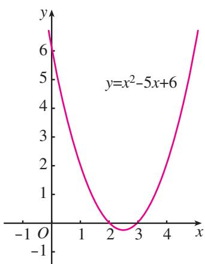

# 例 1 求不等式 $x^{2}-5x+·解析

对应题目：[例 1 求不等式 $x^{2}-5x+](../Q14288615043798539936.md)

分析：因为方程 $x^{2}-5x+6=0$ 的根是函数 $y=x^{2}-5x+6$ 的零点，所以先求出 $x^{2}-5x+6=0$ 的根，再根据函数图象得到 $x^{2}-5x+6>0$ 的解集.

解：对于方程 $x^{2} - 5x + 6 = 0$ ，因为 $\Delta >0$ ，所以它有两个实数根．解得 $x_{1} = 2$ ， $x_{2} = 3$

画出二次函数 $y=x^{2}-5x+6$ 的图象（图 2.3-2），结合图象得不等式 $x^{2}-5x+6>0$ 的解集为 $\{x|x<2, \text{或 }x>3\}$ .

  
图2.3-2

## 所属组织

- [2.3 二次函数与一元二次方程、不等式](61b34f4c592952b5bc592134.md)
