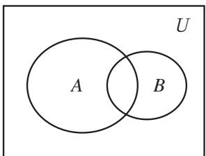
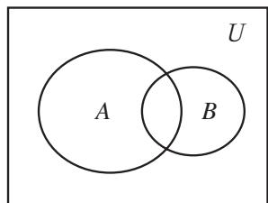

# 练习 3

3. 图中 $U$ 是全集， $A$ ， $B$ 是 $U$ 的两个子集，用阴影表示：

(1) $(\complement_U A) \cap (\complement_U B)$ ; (2) $(\complement_U A) \cup (\complement_U B)$ .

  
(1)

  
(第3题)  
(2)

## 解析

本来源未提供本题解析。

## 本节相关知识（范围关联）

- [交集](cca4219686fc0fb090e29120.md)
- [全集](2e8bf90c5afcf2124f16fb35.md)
- [并集](8107448d8cf71e2c11792597.md)
- [补集](04e5629e192a68591aed2303.md)

## 所属组织

- [1.3 集合的基本运算](4787c0acf3f5fcca91cca083.md)
