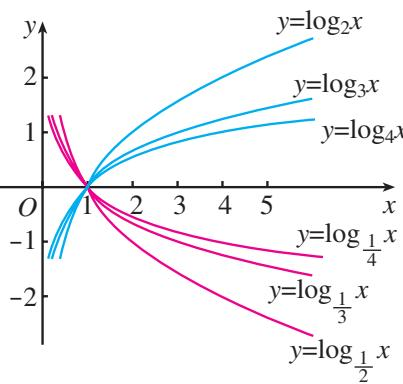
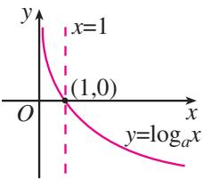
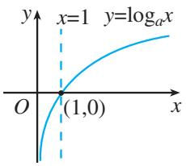

# 对数函数的图象和性质

## 情境引入与思考

## 知识讲解

## 定义摘录（来源原文）

一般地，对数函数的图象和性质如表 4.4-2 所示.

表4.4-2  

<table><tr><td>项目</td><td>01</td><td>a&gt;1</td></tr><tr><td>图象</td><td></td><td></td></tr><tr><td>定义域</td><td colspan="2">(0,+∞)</td></tr><tr><td>值域</td><td colspan="2">R</td></tr><tr><td rowspan="2">性质</td><td colspan="2">(1)过定点(1,0),即x=1时,y=0</td></tr><tr><td>(2)减函数</td><td>(2)增函数</td></tr></table>

图4.4-4

## 先修知识

- [对数函数的概念](5cf1ba73e54db0585b1d8408.md)

## 本节例题与练习

- [例 3 比较下列各题中两个值的大小:](7535afe7f75462f6ca0fcb64.md)
- [例 4 溶液酸碱度的测量.](f78b85ddfbe9015335284a24.md)
- [练习 1](5d7dd50cdd1470eaef2a55a7.md)
- [练习 2](ac1f4dcde59a64a33beff3e8.md)
- [练习 3](c89e4d29f6fb9a657aac0627.md)

## 所属组织

- [4.4.2 对数函数的图象和性质](bd6f4b4b8436571f683e2b1f.md)

## 相关练习组织（范围关联）

- [4.4.2 对数函数的图象和性质](cf78384877f19270153d96fe.md)
