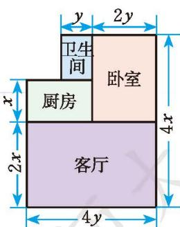

5. (1) 一套住房的部分结构如图所示 (单位: m), 这套房子的主人打算把卧室以外的部分都铺上地砖,至少需要多少平方米的地砖? 如果某种地砖的价格是 $a$ 元 $/ \mathrm{m}^{2}$ , 那么购买所需地砖至少需要多少元?

(第5题)

(2)已知 (1) 中房屋的高度为 $h \mathrm{~m}$ , 现需要在客厅和卧室的墙壁上贴壁纸, 那么至少需要多少平方米的壁纸? 如果某种壁纸的价格是 $b$ 元 $/ \mathrm{m}^{2}$ , 那么购买所需壁纸至少需要多少元 (计算时不扣除门、窗所占的面积)?
